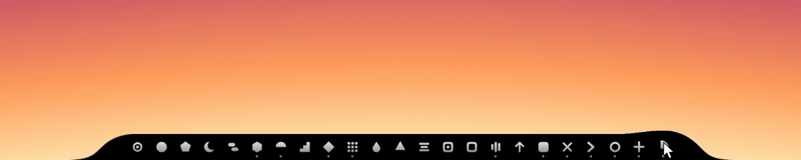

# Notch Liquid Hover

**[Download the full 22-second showcase (MP4, 8.9 MB)](https://github.com/Frozt-src/notch-liquid-hover/raw/main/media/notch-liquid-hover-showcase.mp4)**

*Real recording of the mod running on Windows 11. The icons are neutral placeholders; you will see your own apps.*

A [Windhawk](https://windhawk.net/) mod that adds a liquid hover effect to the **NotchDock** taskbar theme.
Point at an icon and the notch's top edge swells up under it like the surface of a liquid, glides with the
pointer from icon to icon, and sinks back with a soft spring when the pointer leaves. At either end of the
row the notch's curved slope lifts with it. The notch around the clock and system icons does the same.

## Status

- **Not in the Windhawk catalog yet.** For now it is installed from the source in this repository.
- **The NotchDock theme is awaiting review** in the
  [Windows 11 Taskbar Styling Guide](https://github.com/ramensoftware/windows-11-taskbar-styling-guide/pull/729).
  Its notch images load from that repository, so the theme will not draw correctly until it is merged.

## Requirements

- [Windhawk](https://windhawk.net/)
- [Windows 11 Taskbar Styler](https://windhawk.net/mods/windows-11-taskbar-styler) with the NotchDock theme
  applied. Without the theme this mod does nothing: it checks for the NotchDock notch shape and stays idle
  on any other taskbar, so it is safe to leave enabled.
- A taskbar at the bottom of the screen.
- Optional: [Taskbar Dock Animation](https://windhawk.net/mods/taskbar-dock-animation) for icon
  magnification; the two work together.

## Install from source

1. In Windhawk, create a new mod.
2. Replace the template with the contents of [`notch-liquid-hover.wh.cpp`](notch-liquid-hover.wh.cpp).
3. Compile the mod and enable it.

## Clicks go through

The bulge rises a few pixels above the taskbar. Where a maximised window reaches down to the taskbar, that
part of the bulge is drawn in a thin overlay above the window. The overlay is shown only while the bulge is
up, and the mouse does not see it: clicks land on the window underneath.

## Settings

| Setting | What it does | Default |
|---|---|---|
| Dock notch | Turns the effect on or off for the main notch | On |
| Tray notch | Turns the effect on or off for the clock and system icons | On |
| Height | How far the surface may rise, in pixels (2 to 24) | 8 |
| Dock bulge width | Width of the raised stretch on the dock, in pixels (60 to 400) | 168 |
| Tray bulge width | Width of the raised stretch on the tray, in pixels (40 to 300) | 120 |
| Colour | The notch's colour as `#RRGGBB`; it must match the theme's notch | `#000000` |

## Known limitations

- Built for NotchDock's notch shape only; other themes are ignored on purpose.
- The tray's bulge starts working after the dock has been hovered once since Explorer started.
- Tested on Windows 11 build 26300 with one taskbar. Taskbars on secondary monitors, top or side taskbars
  and other builds are untested.

## How it works

It hooks `TaskbarFrame::OnPointerMoved` in Taskbar.View.dll, as Taskbar Dock Animation does, only to learn
that the pointer has arrived and where the taskbar is. From then on a per-frame callback follows the real
cursor, because pointer events stop once a window preview opens. Each bulge is one XAML `Polygon` redrawn
every frame, plus the click-through overlay window described above. Everything the mod adds is removed when
it is disabled or unloaded.

## License

Copyright 2026 [frozt](https://github.com/frozt-src). The code is licensed under the
[Apache License 2.0](LICENSE). If you distribute this mod or a modified version, keep its copyright and
attribution notices, including those in [NOTICE](NOTICE), and mark the files you changed.

The showcase video and GIF in `media/` are not covered by that license; all rights reserved.
